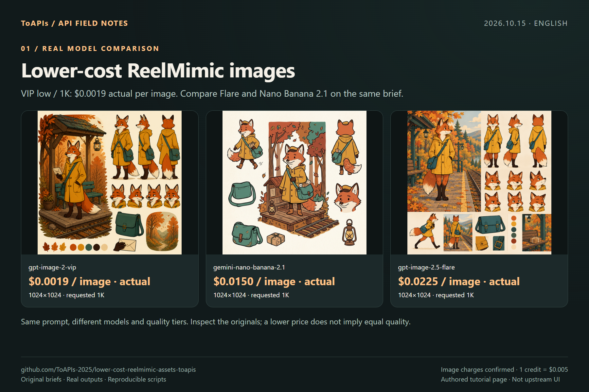

# Lower-cost ReelMimic ToAPIs images

[中文](README_zh-CN.md)

[ToAPIs · model pricing & API](https://go2v.toapis.com/re15ge)

**2026-10-15: 3 real outputs; actual image charges $0.0394 (7.88 credits), confirmed from the backend screenshot.**

External original 2D image generation followed by the unchanged upstream stage-assets.mjs importer. Full agent/video production was not tested.

## Demo



## Prices for the tested models

| Model | Requested preset | Actual pixels | Quote / request | Actual charge |
|---|---|---|---:|---|
| [`gpt-image-2-vip`](https://go2v.toapis.com/re15v) | low / 1K | 1024×1024 | $0.0019 | $0.0019 / 0.38 credits |
| [`gemini-nano-banana-2.1`](https://x.toapis.com/re15n) | 1K | 1024×1024 | $0.0150 | $0.0150 / 3 credits |
| [`gpt-image-2.5-flare`](https://im25.toapis.com/re15f) | high / 1K | 1024×1024 | $0.0225 | $0.0225 / 4.5 credits |

Quoted total: **$0.0394**. Image charges were confirmed from the backend screenshot; 1 credit = $0.005. Global uses owner-provided pricing; other quotes use the live `/v1/pricing` catalog. Different models and quality tiers do not imply equal quality.

## Reproduce

Python 3.11+; Node 22+ for Node/TS native-entry checks.

```bash
python -m pip install Pillow
python generate_case.py --model gpt-image-2-vip --prompt "An original product photograph, no text"
# Dry-run: no network call. Set TOAPIS_API_KEY privately before --live.
python generate_case.py --model gpt-image-2-vip --prompt "An original product photograph, no text" --run-id my-unique-case --output result.png --live
```

`TOAPIS_BASE_URL=https://toapis.com` or `https://toapis.cn`; `/v1` is appended once. `TOAPIS_STATE_DIR` stores private durable task state. `TOAPIS_MAX_IMAGE_USD` defaults to 0.10. Never commit the key or private state.

### Native entry and scope

```bash
node upstream/stage-assets.mjs --from examples --hyperframes demo-project
```

The unchanged upstream importer was executed twice and all imported bytes were compared. See `evidence/native-import.json`. It is a local asset-import check, not the full ReelMimic analysis/agent/render workflow. Original 2D characters only.

### API mapping

`POST /v1/images/generations` → persist returned task ID → `GET /v1/images/generations/{id}` → download result without forwarding the API key to the CDN. Bearer authentication is used only for the API origin. No automatic POST retries. Uncertain submissions remain blocked until reconciled.

The adapter maps explicit pixel hints to aspect ratio and sends model-specific resolution fields. JPEG responses are preserved as original JPEG and separately converted to PNG for display; real pixel sizes are recorded. A requested 1K tier is not a guarantee of exactly 1024×1024 pixels.

## Evidence and screenshot walkthrough

- [Per-task records](evidence/)
- [Original outputs](examples/)
- [Model comparison](screenshots/en/01-models.png)
- [API steps](screenshots/en/02-api.png)
- [Reuse and limits](screenshots/en/03-reuse.png)

Upstream: [edenfunf/reelmimic](https://github.com/edenfunf/reelmimic/tree/bf59f0d7b60cc49cc328c67329300e9d265964d1), pinned `bf59f0d7b60cc49cc328c67329300e9d265964d1`. Community work; no author endorsement or existing partnership is implied. [Attribution](NOTICE.md).

[Dashboard-confirmed itemized image charges](evidence/actual-charges.json). Video submissions without task IDs are excluded and remain unreconciled.
